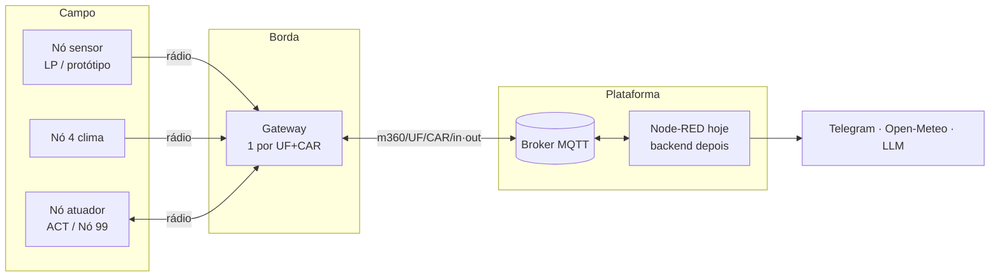
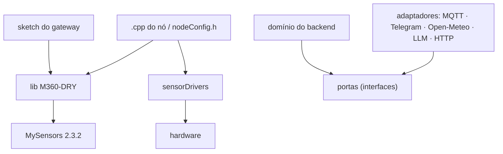
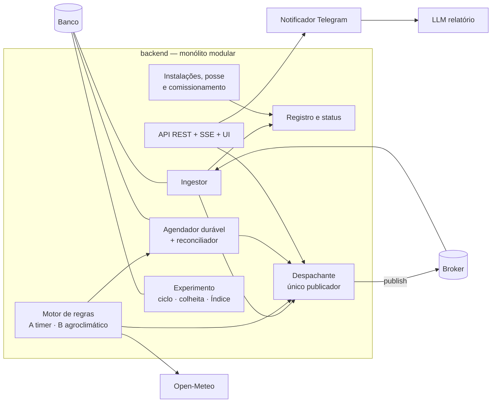
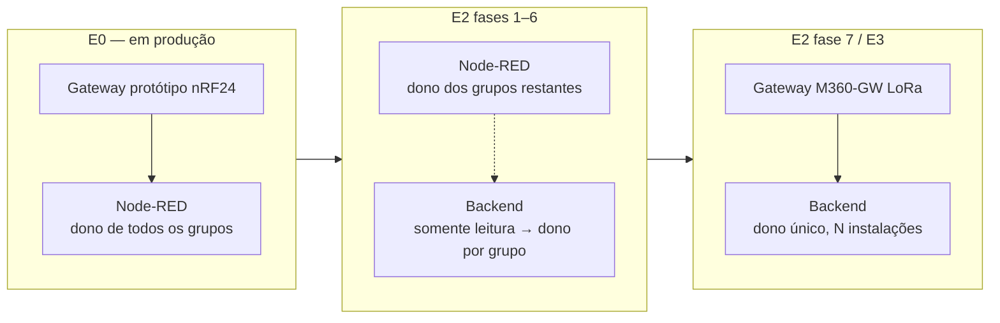

# Architecture Spine — M360 Horta (sistema)

## Design Paradigm

**Hub-and-spoke em três camadas.** Cada camada tem um dono e uma só responsabilidade:

| Camada | Dono de | Onde vive |
| --- | --- | --- |
| **Campo** (nós AVR) | Segurança física: failsafe, exclusão do MUX, energia dos sensores, relé desligado no boot | `lib/M360-DRY/`, `src/DRY/horta/nos/`, `hardware/` |
| **Borda** (gateway ESP8266) | Transporte: ponte rádio ↔ MQTT, validação de formato, heartbeat, configuração local | `lib/M360-DRY/` (`M360Gateway`, `M360Translator`, `M360Webserver`), `src/DRY/*/gateway/` |
| **Plataforma** (Node-RED hoje, backend depois) | Decisão: regras de rega, confirmação de comando, status de nó, histórico, alertas, interface | `src/DRY/horta/nodered/` → `backend/` |

Dentro da plataforma, o backend é um **monólito modular hexagonal**: o domínio (registro, comandos, irrigação, volume, vigilância, instalações, experimento) não conhece MQTT, Telegram, Open-Meteo nem o modelo de linguagem; esses entram por adaptadores. Dentro do nó, a lib M360-DRY segue o mesmo princípio: o `.cpp` do nó é declarativo e o hardware entra por callbacks `onRead`/`onWrite`.



## Invariants & Rules



As setas indicam "pode depender de". O domínio nunca importa um adaptador. O nó nunca chama `send()` fora da lib.

### AD-1 — O inventário é o contrato entre campo e plataforma [ADOPTED]

- **Binds:** F1–F4, F9–F14; todo `NODE_ITEMS[]`, `nodeConfig.h` e configuração de atuadores da plataforma
- **Prevents:** child renumerado ou failsafe alterado no firmware e não na plataforma; o nó ignora o comando em silêncio, ou a plataforma deixa a rega passar do failsafe.
- **Rule:** por env (variante de placa), o `src/DRY/horta/inventario.md` define child ID, rótulo, `S_*`, `V_*`, `kind`, escala, perfil, failsafe de cada atuador, grupo de exclusão (`mux99` = 31–37) e janela de despertar dos nós que dormem. Mudar qualquer um exige atualizar, na mesma entrega, o firmware, o inventário e a configuração da plataforma. A partir da E2, um teste de contrato na CI compara o inventário com a configuração do backend e falha na divergência.

### AD-2 — Segurança física é do nó, nunca da plataforma [ADOPTED]

- **Binds:** F4, F10; firmware do Nó 99 e da ACT; todo componente que agenda desligamento
- **Prevents:** um relé que só desliga se a plataforma estiver de pé; um relé mantido ligado sem fim por ONs repetidos.
- **Rule:** o failsafe, a exclusão mútua do MUX e o estado desligado no boot ficam no firmware, e nenhuma camada acima os desativa. O limite vale sobre o **tempo contínuo ligado** do child: um ON para um child já ligado não rearma o prazo. A plataforma recusa ON em child que está ligado ou incerto, conta o limite de `failsafe − 15 s` a partir do **primeiro publish** do ON e trata o failsafe como última barreira. As bombas NFT (38, 39) não têm failsafe por projeto; para elas a plataforma é a única barreira e o PRD registra o risco.
- **Implementação:** até 2026-10-17 `armFailsafe()` (`99nodeReles.cpp`) rearmava o prazo a cada ON. Corrigido na história 3.11; falta gravar e testar em bancada.

### AD-3 — Confirmação é o eco de aplicação [ADOPTED]

- **Binds:** F9, F10, F13; gateway (`dispatchCommand()`), Node-RED (Sincronizador ACK), backend (despachante)
- **Prevents:** comando "confirmado" com o nó desligado, porque o ACK do próximo salto respondeu.
- **Rule:** uma atuação só é confirmada por mensagem do nó-alvo com `command=1`, `ack=0`, `type=V_STATUS`, mesmo child e payload igual ao pedido. Comandos administrativos com efeito persistente confirmam pela leitura que o nó devolve (o child 254 para o intervalo). O ACK de transporte (`ack=1`) é anotado e nunca confirma nem grava estado de atuador. Durante a convivência, comando visto em `in/#` que o backend não emitiu é registrado como externo e participa da correlação, para que o eco dele não vire "não solicitado".

### AD-4 — Gramática MQTT única, montada por função e sem retenção em `in/` [ADOPTED]

- **Binds:** F7, F9, F11, F15; gateway, Node-RED, backend, simulador
- **Prevents:** dois produtores com ordem de segmentos diferente; payload JSON num comando de relé; comando retido que religa o relé a cada reconexão do gateway.
- **Rule:** prefixo `m360/{UF}/{CAR}`. Medições e comandos no formato nativo `{prefixo}/{out|in}/{node}/{child}/{command}/{ack}/{type}`, payload = valor bruto, com os limites de `Translator::validate()` (spec §2.3). Heartbeat em `{prefixo}/out`, eventos em `{prefixo}/out/events`, métricas em `{prefixo}/gateway/status`. Payload de `V_STATUS` é só `"0"` ou `"1"`. Publicar em `in/#` com `retain` é proibido: o broker recusa e o backend audita. O produtor publica só o nativo; o consumidor aceita nativo e envelope JSON. Cada tópico tem **uma** função construtora na lib e uma no backend; a validação de comando usa um único arquivo de vetores (tópico, payload, resultado) rodado pelos testes da lib e pela CI do backend. Heartbeat, `gateway/status` e eventos ganham campo `schema` versionado antes da E3.

### AD-5 — Só o despachante envia

- **Binds:** F7, F9, F10
- **Prevents:** um caminho de envio que pula validação, retry, serialização do MUX ou registro de origem.
- **Rule:** no gateway, todo comando ao rádio passa por `dispatchCommand()`, que valida, envia e publica sucesso ou `command_rejected`/`command_send_failed` [ADOPTED no gateway Horta]. No backend, **só o despachante publica** no broker; agendador, regras, reconciliador e botões criam comandos, nunca publicam. O gateway do Kit Hélio ainda não segue a regra (usa `atoi()` no tópico, descarta com `println`, envia com `send(..., true)`) e precisa ser alinhado antes de virar instalação (épico 9, história 9.7).

### AD-6 — Um dono por grupo físico de atuadores

- **Binds:** F10, F13; migração Node-RED → backend (spec §10)
- **Prevents:** Node-RED e backend comandando o mesmo MUX, com a preempção de um cortando a rega do outro.
- **Rule:** a unidade de posse é o grupo de exclusão física: `mux99` (31–37) inteiro, 38 e 39 cada um por si. Nenhuma fase divide um grupo. A posse é publicada pelo backend num tópico retido de plataforma, lido também pelo Node-RED, e aparece no health. A troca de posse só acontece com o grupo quieto (nenhum atuador ligado, nenhuma rega aberta) e leva junto o estado: regas abertas, OFFs pendentes, `last_irrigation_at` e contadores. O rollback faz a troca inversa pela mesma regra. Comando a um grupo vindo de quem não é dono gera alerta.

### AD-7 — Ação futura é linha persistida, e ON vencido nunca executa

- **Binds:** F10, F12; backend (agendador, regras, rega manual)
- **Prevents:** OFF de rega num `setTimeout` que some no restart; ON atrasado que liga uma solenóide horas depois.
- **Rule:** todo desligamento agendado, retry e notificação adiada é uma linha no agendador durável, com chave de idempotência e validade. Ao reiniciar, OFFs vencidos executam; ONs vencidos são descartados e registrados. Toda ligação de atuador com failsafe nasce junto com o seu OFF. Ligar uma solenóide de canteiro é sempre uma rega (automática ou manual), nunca um comando solto. Um reconciliador periódico fecha regas vencidas e desliga solenóide ligada sem rega ativa.

### AD-8 — Gateway sem regra de negócio [ADOPTED]

- **Binds:** F7, F10
- **Prevents:** regra de rega duplicada no gateway (o antigo `rules.json`) e na plataforma.
- **Rule:** o gateway valida formato e faixa, roteia, reporta e guarda a própria configuração. Decidir quando regar, confirmar comando, calcular status de nó ou guardar histórico é da plataforma. Eventos de nó do gateway (`node_lost`, `node_reconnected`) são evidência persistida e nunca disparam alerta por si: o status de nó tem um único dono, o backend.

### AD-9 — Firmware por placa, configuração por nó [ADOPTED]

- **Binds:** F1–F8, F12; `src/DRY/horta/platformio.ini`, `nos/lp/`, `nos/99nodeReles/`, gateways
- **Prevents:** um `.cpp` por nó que diverge da lib; ou um binário genérico que não cabe na RAM.
- **Rule:** a LP tem um fonte único e cada nó é um `config/<nó>/nodeConfig.h` mais um env. ACT e GW usam o fonte do protótipo com flag de placa (`NODE99_BOARD_ACT`, `M360_BOARD_GW`). Macros `MY_*` só no `platformio.ini`; a única exceção prevista é a frequência LoRa, que vira variável lida da EEPROM na E3 (AD-14). Os envs dos protótipos continuam servindo o hardware em campo. Nó novo segue `.agent/workflows/m360-node-factory.md`.

### AD-10 — A lib M360-DRY é o único motor de ciclo de vida [ADOPTED]

- **Binds:** F1–F9; todo nó novo e todo gateway
- **Prevents:** ciclo de vida reimplementado por nó; uso do motor legado em código novo.
- **Rule:** nó novo usa `M360::M360Node` com `NODE_ITEMS[]` declarativo e drivers por callback; rótulos em `PROGMEM`; envio pelo `MyMessage` interno da lib. `src/DRY/horta/nos/shared/` é legado e congelado. Mudança na lib passa por `pio check -e check_m360_dry` limpo e pelo orçamento de RAM do AD-20.

### AD-11 — Children reservados e comandos administrativos [ADOPTED]

- **Binds:** F5, F6, F8, F9, F16
- **Prevents:** um recurso novo reaproveitando um child reservado, como o reset remoto proposto no child 254.
- **Rule:** 253 = debug remoto (`V_TEXT`), 254 = intervalo (`V_VAR1`), 255 = bateria (`V_VOLTAGE`), em todo nó. Comandos administrativos entram como `V_CUSTOM` no child 0 (`FORCE_UPDATE`, `REPRESENT`, `DEBUG_NET` e os futuros `SET_RADIO` e reset remoto). Nenhum novo significado para 253–255.

### AD-12 — Um mapa de EEPROM por MCU, com dono por faixa [ADOPTED]

- **Binds:** F5, F7, F15, F16
- **Prevents:** duas histórias paralelas escolhendo o mesmo byte; área de perfil sobreposta à configuração (o spine antigo propunha 514–520).
- **Rule:**
  - **Nó (ATmega328P):** 0–511 MySensors; 512–515 intervalo (magic + valor, só por `M360::saveInterval()`); 516–520 reservado, com o byte 516 já destinado ao índice de canal LoRa da E3. Perfil e identidade do F16 ganham faixa nova acima de 520, documentada aqui antes do código.
  - **Gateway (ESP8266):** 0–511 MySensors; 512–520 reservado; 521+ `M360DeviceConfig` com CRC, escrita só por `saveConfig()`, campo a campo.
  - Cada tipo de reset declara o que apaga: o factory reset do gateway apaga 521+; o reset remoto de nó (F16) apaga identidade e perfil e preserva o intervalo.

### AD-13 — Identidade da instalação é o prefixo; um gateway por propriedade

- **Binds:** F15, F6; backend (toda tabela e toda consulta), gateway (UF, CAR)
- **Prevents:** dados ou comandos de uma propriedade vazando para outra; gateway novo ou resetado subindo no prefixo do piloto.
- **Rule:** uma instalação = um par UF+código = um prefixo MQTT = um gateway [ADOPTED]. O código do prefixo tem até 7 caracteres `[A-Za-z0-9]`, é atribuído pela plataforma e único por UF; o número real do CAR é atributo da instalação. O padrão de fábrica do firmware nunca é um prefixo válido de produção: gateway sem configuração sobe em AP e não publica. A plataforma separa o que é dela (administrador, chat de operação, credencial de serviço) do que é da instalação (chat principal, assinantes, posse, somente leitura); nenhuma notificação de instalação vai a destino de plataforma, salvo as de provisionamento. Na E3, o heartbeat leva o ID do chip, vinculado à instalação; outro ID no mesmo prefixo gera `gateway_conflict` e suspende comandos.
- **Defeito aberto:** hoje o padrão de fábrica vem de `include/M360Credentials.h`, que é o prefixo do piloto. Correção antes da E3 (épico 10, história 10.4).

### AD-14 — Isolamento de rádio por frequência, não por aplicação (decidido, não implementado)

- **Binds:** F6, F15, F16
- **Prevents:** filtrar vizinho na aplicação depois que o driver já deu ACK; um `SET_RADIO` de uma propriedade nova tirando de canal o nó do piloto.
- **Rule:** propriedades LoRa vizinhas se separam por canal da grade D-09 (`f = 915,2 + 0,2·k` MHz, k = 0..63). O canal é estado da instalação na plataforma e da configuração do gateway; a plataforma é a única dona da atribuição. O canal de fábrica (k = 8) fica reservado ao comissionamento: o piloto sai dele antes da E3. `SET_RADIO` só é aceito pelo nó numa janela de presença física (ímã ou início do boot), ecoa antes de trocar e volta ao canal anterior se não achar o gateway. Redes nRF24 não têm isolamento: nunca operam ao alcance uma da outra, ou recebem `MY_RF24_BASE_RADIO_ID` distinto, com medição.

### AD-15 — Rádio escolhido na compilação; troca é por rede [ADOPTED]

- **Binds:** F6; `[common] radio_flags`, `[proto_rf24]`, `[kit_helio]`
- **Prevents:** nós da mesma rede compilados com rádios diferentes.
- **Rule:** um rádio por placa e por rede. A escolha do tipo de rádio é feita no `platformio.ini`; protótipos e Kit Hélio ficam fixos em nRF24. Migrar uma rede para LoRa é um corte: gateway e todos os nós daquela propriedade trocam juntos.

### AD-16 — Leitura bruta é a verdade; conversão é exibição [ADOPTED]

- **Binds:** F1, F3, F10, F11
- **Prevents:** o motor decidindo em percentual derivado enquanto o firmware publica ADC; solo seco e estável tratado como "sem leitura".
- **Rule:** cada leitura guarda o valor bruto e o convertido com unidade. Regras usam o bruto (solo em ADC 0–1023, alto = seco). A conversão vem do tipo do child (`S_MOISTURE`), não de uma lista de nós. A validade de uma leitura para uma regra se mede pela idade do último contato do nó, não pela última mudança de valor, porque o nó só envia por mudança ou a cada 10 ciclos.

### AD-17 — Tempo e relógio

- **Binds:** F10, F11, F12, F15
- **Prevents:** rega agendada pelo relógio do gateway ou no fuso do servidor; volume e cadência distorcidos por rajada de mensagens enfileiradas.
- **Rule:** horários persistidos em UTC. Agenda e exibição no fuso da instalação (America/Sao_Paulo no piloto). O relógio e o uptime do gateway servem só para detectar reboot. Leituras entregues de fila depois de uma reconexão são marcadas como atrasadas e ficam fora da cadência e da integração de volume.

### AD-18 — Segredos fora do repositório; ausência impede o start [ADOPTED]

- **Binds:** todos
- **Prevents:** credencial em commit; serviço que sobe com token vazio e falha em silêncio.
- **Rule:** firmware lê segredos de `include/M360Credentials.h` (fora do Git). Node-RED usa `%USERPROFILE%\.m360\nodered.env` via `nr_deploy.py`. O backend lê do ambiente e recusa iniciar sem um segredo obrigatório.

### AD-19 — Um dono por tipo de configuração

- **Binds:** F9, F10, F13, F15
- **Prevents:** atuadores e canteiros definidos ao mesmo tempo no YAML, no banco e no inventário, com três verdades.
- **Rule:** o inventário é dono do que o firmware fixa (AD-1). O banco é dono da configuração de produção da plataforma (canteiros, regras, parâmetros, posse). O YAML só semeia um banco vazio e alimenta testes; ao subir com banco preenchido, o YAML é ignorado. O teste de contrato do AD-1 roda contra o banco.

### AD-20 — Orçamento de RAM dos nós

- **Binds:** F1–F9, F16; lib M360-DRY e todo env AVR
- **Prevents:** uma mudança na lib que estoura a pilha do Nó 99 sem nenhum gate.
- **Rule:** toda mudança na lib ou num nó compila todos os `default_envs` e confere pelo menos 512 B de RAM livre (2048 menos a RAM estática do build) em `act_99` e `nano_99reles`. Recursos que custam RAM (assinatura, perfil em EEPROM) só entram com medição em hardware.

### AD-21 — Volume por canteiro e dados do experimento

- **Binds:** F3, F14
- **Prevents:** litros atribuídos ao canteiro errado; dois contadores de volume com totais diferentes.
- **Rule:** o contador oficial de volume é o do backend desde a fase 1; o valor do Node-RED entra uma vez como deslocamento inicial datado, nunca como sobrescrita. O volume de uma rega é a integração do child 21 durante a rega, atribuída ao canteiro só quando um único canal do `mux99` está ativo. Ciclo, colheita e indicadores (F14) são entidades do domínio do backend, escopadas por instalação.

### AD-22 — Nenhum estado bloqueia o desligamento

- **Binds:** F9, F10, F15
- **Prevents:** uma instalação suspensa, um backend somente-leitura ou um grupo em troca de posse impedindo um OFF de segurança.
- **Rule:** `SUSPENSA`, somente-leitura e qualquer bloqueio de comando recusam ON e comandos administrativos, mas nunca recusam OFF de atuador.

## Consistency Conventions

| Concern | Convention |
| --- | --- |
| Idioma | Comentários, logs Serial, documentos e mensagens ao usuário em português |
| Nomes de nós e children | Pelo `inventario.md`; rótulos curtos, os mesmos no firmware, no painel e no Telegram |
| IDs de nó | Vêm do env por instalação até o F16; as faixas de `M360Constants.h` são legado |
| Precisão | Floats com 1 casa decimal no firmware (`set(val, 1)`) |
| Enums de estado | A spec do backend §5 é a dona única dos estados de comando, nó, instalação e gateway; o spine e a UI referenciam, não copiam |
| Janela de despertar LP | Valor da lib (`smartSleep`), declarado no inventário; o backend lê de lá |
| Eventos do gateway | snake_case em `out/events` (`node_lost`, `command_rejected`, `factory_reset`…) |
| Erros no gateway | Comando malformado vira evento publicado com motivo, nunca só `println` |
| Parsing de tópico | `parseTopicByte()` no gateway; segmento não numérico é rejeitado e contado |
| JSON no gateway | `DynamicJsonDocument` 512 (mensagem), 384 (heartbeat), 256 (evento) |
| Versão de firmware | Cada sketch reporta a versão no `presentation()`; mudança de comportamento sobe a versão; o env gravado em cada nó fica registrado no inventário |
| Testes | Lib: `pio check` + build de todos os `default_envs` + orçamento de RAM. Backend: simulador + teste de contrato + vetores de validação na CI. Hardware: netdiff + ERC zero + bancada (SM-7) |
| Mudança em esquemático | Netlist antes e depois, `netdiff.py`, ERC zero (`.agent/skills/m360-kicad-hardware-workflow/SKILL.md`) |
| Deploy do Node-RED | `nr_deploy.py` na ordem backup → diff → `deploy --tab` → diff |

## Stack

| Name | Version |
| --- | --- |
| PlatformIO platform espressif8266 | 2.6.3 (fixada) |
| PlatformIO platform atmelavr | 5.2.0 instalada; não fixada nos envs (fixar em `@5.2.0`) |
| Framework | Arduino |
| MySensors | 2.3.2 (faixa `^2.3.2` no ini; as armadilhas documentadas valem para a 2.3.2: fixar exata) |
| ArduinoJson (gateway) | `^6.21.3`, resolve 6.21.6 |
| PubSubClient (gateway) | `^2.8` |
| DHT sensor library · Adafruit Unified Sensor | `^1.4.6` · `^1.1.14` |
| DallasTemperature · OneWire | `^3.9.1` (resolve 3.11.0) · `^2.3.7` (resolve 2.3.8) |
| Lib M360-DRY | 2.2.0 |
| MCU dos nós | ATmega328P (Pro Mini 3,3 V/8 MHz nas placas M360) |
| MCU do gateway | ESP8266 (D1 mini) |
| Rádio LoRa | RFM95W, 916,8 MHz (k = 8), BW125 CR4/5 SF7, 17 dBm; BW e grade dependem da consulta ANATEL (PRD Q-7) |
| Rádio legado | nRF24L01+, canal 76, 250 kbps, PA_HIGH |
| KiCad · Freerouting | 10.0.4 · 1.9.0 (Java 17) |
| Análise estática | cppcheck do PlatformIO (`check_m360_dry`) |
| Node-RED · broker MQTT | versões do servidor de produção, não registradas no repositório |
| Backend | não decidido (D-01, D-02, D-03); ver Deferred |

## Structural Seed





```text
m360_horta/
  lib/M360-DRY/            # motor de nó e de gateway (campo + borda)
  src/DRY/horta/
    gateway/               # sketch do gateway Horta
    nos/lp/                # fonte único da M360-LP; config/<nó>/nodeConfig.h
    nos/99nodeReles/       # Nó 99 (Nano e ACT)
    nos/04noodeSolarMini/  # Nó 4 (clima)
    nos/shared/            # motor legado, congelado
    nodered/               # flows.json + nr_deploy.py (legado após o corte)
    inventario.md          # contrato (AD-1)
  src/DRY/kit-helio/       # gateway e nó do Kit Hélio
  hardware/                # placas M360 (KiCad)
  backend/                 # backend (a criar na E2 fase 0)
  test/vectors/            # vetores de validação de comando (AD-4), a criar
  docs/                    # especificações normativas e relatórios
  _bmad-output/            # PRD, arquitetura, épicos, sprint
```

## Capability → Architecture Map

| Capability / Area | Lives in | Governed by |
| --- | --- | --- |
| F1 Solo multiponto | `nos/lp`, Nós 1/2 protótipo | AD-1, AD-9, AD-10, AD-16 |
| F2 Clima | Nó 4; plataforma (fonte de clima) | AD-1, AD-16 |
| F3 Vazão e volume | Nó 99/ACT; backend (volume) | AD-1, AD-7, AD-21 |
| F4 Atuação segura | Nó 99/ACT | AD-2, AD-9, AD-22 |
| F5 Energia | lib M360-DRY (perfis), LP | AD-10, AD-12, AD-20 |
| F6 Rádio | `platformio.ini`, mezanino RF | AD-14, AD-15 |
| F7 Gateway e portal | lib (`M360Gateway`, `M360Webserver`), sketch | AD-4, AD-5, AD-8, AD-12, AD-13 |
| F8 Reed | lib (`forceUpdate`, `requestRejoin`, `FactoryReset`) | AD-2, AD-11, AD-12 |
| F9 Comandos | gateway (`dispatchCommand`); backend (despachante) | AD-3, AD-5, AD-22 |
| F10 Irrigação A × B | Node-RED aba Irrigação → backend (regras + agendador) | AD-2, AD-6, AD-7, AD-16, AD-17 |
| F11 Registro e vigilância | Node-RED aba ACK Handling → backend (ingestor + registro) | AD-1, AD-4, AD-8, AD-16 |
| F12 Telegram | Node-RED abas Telegram/IA → backend (notificador) | AD-7, AD-13, AD-18 |
| F13 Painel e API | Node-RED dashboard → backend (API + UI) | AD-3, AD-5, AD-6, AD-18 |
| F14 Indicadores do experimento | backend (experimento) | AD-21 |
| F15 Multi-propriedade | backend (instalações) + gateway (UF, código, canal) | AD-12, AD-13, AD-14, AD-19 |
| F16 Pareamento e firmware genérico | futuro: lib + gateway + backend | AD-11, AD-12, AD-14, AD-20 |

## Ajustes pendentes na spec do backend

O spine diverge da spec v1.3 nestes pontos. Valem o spine e a revisão da spec antes da fase 0 da E2.

| Spec | Divergência | AD |
| --- | --- | --- |
| §10, fase 3 | Botões manuais do MUX no backend com a aba Irrigação no Node-RED dividem o `mux99`. A fase 3 passa a cobrir só as bombas 38/39 e os comandos administrativos; os botões do MUX vão para a fase 4, junto com a irrigação | AD-6 |
| §10, migração de dados | Faltam `last_irrigation_at`, regas abertas e o volume como deslocamento inicial | AD-6, AD-21 |
| §5.4 | "Ações vencidas executadas imediatamente" sem separar ON de OFF | AD-7 |
| §5.1 e RF-CMD-01 | O diagrama deixa o agendador publicar | AD-5 |
| RF-PRV-06 | `SUSPENSA` recusa comandos sem exceção para OFF | AD-22 |
| RF-PRV-09 | O boot depois do factory reset usa o padrão de compilação, que é o prefixo do piloto | AD-13 |
| RF-WDG-02 | Eventos de nó do gateway alimentam alerta | AD-8 |

## Deferred

| Decisão | Por que pode esperar | Quando decidir |
| --- | --- | --- |
| Linguagem e runtime do backend (D-01) | O paradigma e os ADs valem para qualquer runtime; a spec recomenda Python 3.12 + FastAPI | Antes da fase 0 da E2 |
| Banco (D-02) | O esquema lógico está na spec §5.2; a recomendação é PostgreSQL 16 | Antes da fase 0 |
| Tecnologia da UI (D-03) | A UI consome a API; não muda o domínio | Antes da fase 2 |
| Hospedagem, ambientes e backup (D-05) | O backend só lê até a fase 3; a recomendação é containers no servidor atual, com broker de teste e simulador na CI (spec §11, §12.1) | Antes da fase 0 |
| Observabilidade (log estruturado, métricas, health) | Coberta pela spec RNF-05; só a forma depende de D-01 | Fase 0 |
| Broker: produto, versão, ACL por prefixo e TLS | O broker atual atende o piloto; ACL por instalação é da E3 | Antes da E3 |
| Autenticação e papéis (D-06) | Um papel `admin` basta para o piloto | Antes da fase 2 (admin) e da E3 (papéis) |
| Kit Hélio como instalação (D-08) | Só leitura, sem atuador; exige o gateway alinhado ao AD-5 | Planejamento da E3 |
| Pareamento, ID e perfil pelo backend, reset remoto de nó (F16) | Exige E3 pronta; o comissionamento manual atende o piloto. Ligado a D-09 e à spec §15 | Depois da E3 |
| Autenticação do portal do gateway | O gateway do piloto está na rede do dono | E3 |
| Assinatura de mensagens MySensors | Sem folga de RAM comprovada em hardware (AD-20) | Depois da bancada da ACT |
| Atualização de firmware em campo (OTA) | Gravação em bancada atende o volume atual | Quando houver mais de uma propriedade |
