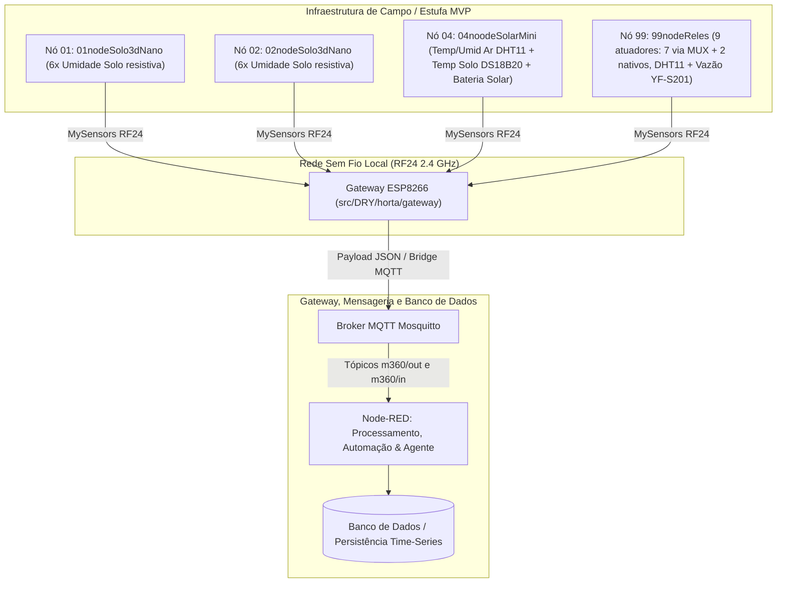

# Relatório Técnico de Atividades Desenvolvidas — Sistema Manejo360

**Projeto:** Sistema IoT de Monitoramento e Automação Agrícola — **Manejo360**  
**Repositório Base:** `c:\Users\jmarc\Documents\PlatformIO\Projects\m360_horta`  
**Finalidade:** Comprovação técnica de serviços executados, medição de entregáveis e fundamentação para emissão de Nota Fiscal de Serviços (NFS-e).  
**Enquadramento Principal:** Código de Tributação Nacional **01.07.01** (*Suporte técnico em informática, inclusive instalação, configuração e manutenção de programas de computação e bancos de dados* / Item 1.07 da LC 116/03).

---

## 1. Sumário Executivo do Projeto

O sistema **Manejo360** é uma infraestrutura integrada de computação embarcada, telemetria em tempo real e automação agrícola. O projeto abrange desde a programação em baixo nível de microcontroladores (firmware C++/PlatformIO) até a camada de recepção e processamento de dados (Gateway ESP8266, broker MQTT, fluxos Node-RED e bancos de dados de telemetria).

### Arquitetura Operacional Homologada em Campo

---

## 2. Consolidação das Atividades por Frentes Técnicas

### 2.1 Engenharia de Software, Firmware e Protocolos Lógicos
* **Arquitetura Monorepo e LibDRY:** Desenvolvimento da biblioteca reutilizável `M360Node`, `M360Gateway` e padronização do motor de execução `node_engine.h`, eliminando duplicidade de código nos ambientes ATmega328P e ESP8266.
* **Gerenciamento de Perfis de Energia:** Implementação de rotinas de baixo consumo (`POWER_PROFILE_LOW_POWER` com suspensão de rádio e sleep profundo) para nós solares/bateria e regime contínuo (`POWER_PROFILE_ALWAYS_ON`) para controladores de relés.
* **Comunicação e Tradução de Payloads:** Criação da camada de abstração `M360Translator` para conversão bidirecional entre pacotes binários MySensors v2.3.2 e estruturas JSON padronizadas no MQTT.
* **Segurança e Estabilidade Lógica:** Revisão de código e análise estática (cppcheck via `pio check`) eliminando estouros de buffer de mensagens; na M360-DRY 2.0.0 o vetor `messages[]` por nó foi substituído por um único buffer de envio, liberando ~710 B de SRAM nos nós ATmega328P.

### 2.2 Hardware, Integração Eletrônica e Bancada
* **Comissionamento e Homologação de Nós:** Montagem, parametrização e carga de firmware em 4 nós coletores/atuadores:
  * **Nó 01 e Nó 02 (Solo 3D):** Leitura de umidade do solo resistiva em 6 canais por nó, rotulados por canteiro, distância e profundidade (`<canteiro>_<distância>_<profundidade>`).
  * **Nó 04 (Estação Solar Mini):** Monitoramento microclimático aéreo (DHT11), temperatura do solo (DS18B20) e tensão da bateria carregada por painel solar.
  * **Nó 99 (Atuação Hidráulica):** 9 atuadores (7 via multiplexador + 2 nativos) para válvulas solenoides e bombas de irrigação, com failsafe de tempo máximo ligado, DHT11 e medição volumétrica via sensor de vazão YF-S201.
* **Gateway Central ESP8266:** Parametrização do módulo de rádio NRF24L01+ com amplificador PA/LNA, configuração de interface web em modo AP/Station para provisionamento WiFi e bridge MQTT.
* **Engenharia de Placas e Adaptação:** Desenvolvimento de esquema elétrico e layout PCB no KiCad para o módulo adaptador de soquete **RFM95W (LoRa) para NRF24L01+**, assegurando flexibilidade de transceptores sem troca da placa-mãe.
* **Testes de Bancada e Validação Elétrica:** Testes de estabilidade de sinal RF24, verificação de capacitores de desacoplamento, medição de consumo em regime de sleep e ensaios de continuidade de barramentos 12V/5V.

### 2.3 Banco de Dados, Mensageria e Automação (Node-RED)
* **Estruturação de Tópicos MQTT:** Padronização da taxonomia de publicação e subscrição (`m360/out/...` e `m360/in/...`) para comandos e telemetria.
* **Persistência e Otimização de I/O:** Configuração de fluxos no Node-RED com armazenamento de logs de alta frequência em memória RAM (*File Context Store / RAM*), eliminando gargalos de I/O em disco e falhas `ENOENT`.
* **Mecanismos de Sincronismo e ACK:** Implementação de rotinas de confirmação de entrega para acionamento de solenoides e motor de auto-apresentação (`REPRESENT`).

---

## 3. Matriz de Rastreabilidade dos Marcos e Entregáveis

| Marco / Referência | Período / Data | Principais Entregáveis e Atividades Executadas |
|---|:---:|---|
| **Marco 1** (NF 1) | 13/02/2026 | Concepção da arquitetura Manejo360; criação da biblioteca M360-DRY; drivers base de sensores; abstração inicial do Gateway ESP8266; documentação técnica de requisitos e modelo de negócio. |
| **Marco 2** (NF 2) | 04/05/2026 | Estruturação da estufa MVP; classes `M360Node` e `M360Translator`; perfis de energia; projeto KiCad do adaptador RFM95W/NRF24; especificação de banco de dados time-series e API MQTT v1.0. |
| **Marco 3** (NF 3) | 07/08/2026 | Instalação e comissionamento em campo (Gateway + 4 Nós + 12 Sensores); controle de atuadores `99nodeReles`; orquestração do Agente no Node-RED; padronização de EEPROM em `node_engine.h`. |
| **Sustentação Contínua** | 2026 | Manutenção preventiva/corretiva de firmware, monitoramento de conectividade, calibração de sensores e sustentação dos bancos de dados. |
