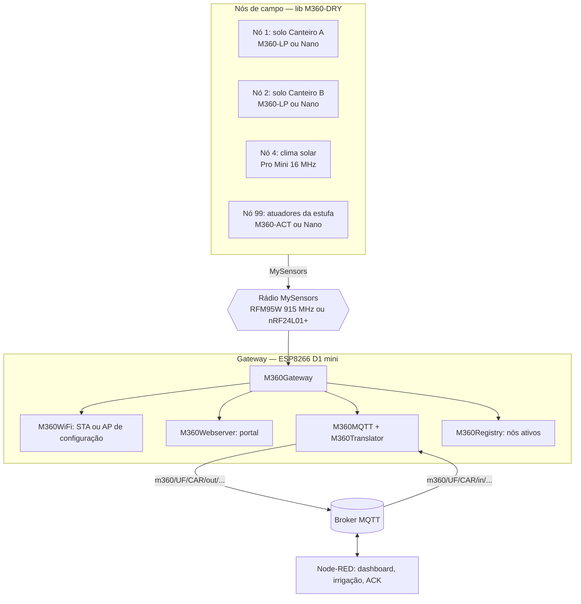

# Firmware M360 Horta — `src/DRY/`

Código dos nós de campo, dos gateways e dos fluxos Node-RED do sistema de monitoramento
agrícola **M360 Horta**, organizado em dois sub-projetos agregados pelo `platformio.ini` da raiz
(`extra_configs`). Todo nó e gateway usa a biblioteca **[M360-DRY 2.2.0](../../lib/M360-DRY/)**
sobre **MySensors 2.3.2**. O motor legado em `horta/nos/shared/` continua no repositório, mas
nenhum nó novo o usa.

> As regras de trabalho vivem em [`CLAUDE.md`](../../CLAUDE.md) (raiz), no skill
> [`bmad-mysensors-node-coding`](../../.agent/skills/bmad-mysensors-node-coding/SKILL.md) e no
> workflow [`m360-node-factory`](../../.agent/workflows/m360-node-factory.md). Este README é um
> mapa; a autoridade sobre nós e child IDs é o [`inventario.md`](horta/inventario.md).

---

## Visão geral



O Kit Hélio é uma instalação separada, fixa em nRF24L01+ (não segue o `radio_flags` da Horta), com o mesmo gateway e um nó DHT11 (Nó 11), em
`kit-helio/`.

---

## Estrutura de diretórios

```text
src/DRY/
├── README.md                     este arquivo
├── horta/                        sub-projeto Horta (platformio.ini próprio)
│   ├── platformio.ini            envs da Horta e perfis de rádio ([radio_rf24], [radio_rfm95])
│   ├── inventario.md             nós, child IDs e contrato com o Node-RED
│   ├── gateway/                  libDryGatewayMqtt.cpp (ver README.md da pasta)
│   ├── nodered/                  flows.json, DEPLOY.md e tools/nr_deploy.py
│   └── nos/
│       ├── README.md             como criar um nó; perfis de energia
│       ├── lp/                   firmware comum da placa M360-LP + config/<nó>/nodeConfig.h
│       ├── 01nodeSolo3dNano/     Nó 1 no Nano (legado): 6 eletrodos em A0–A5
│       ├── 02nodeSolo3dNano/     Nó 2 no Nano (legado): idem, Canteiro B
│       ├── 04noodeSolarMini/     Nó 4: DHT11 + DS18B20, solar, LOW_POWER
│       ├── 99nodeReles/          Nó 99: 9 relés + vazão (+ DHT11 só no Nano); Nano ou M360-ACT
│       ├── 01nodeSolo3dMini/     documentação defasada de um projeto de 18 canais (sem firmware)
│       └── shared/               motor legado node_engine.h — não usar em novos nós
└── kit-helio/                    sub-projeto Kit Hélio (platformio.ini próprio)
    ├── gateway/                  libDryGatewayMqtt.cpp do Kit Hélio
    └── nos/miniDHT/              Nó 11: DHT11, ALWAYS_ON
```

Não existem mais `gateway/ngm/` nem `withLibDRY/`: a infraestrutura do gateway (WiFi, MQTT,
webserver, LEDs, EEPROM, registro de nós) vive em `lib/M360-DRY/`, e cada nó fica direto na sua
pasta.

---

## Rádio

O rádio ativo é escolhido uma vez, em `horta/platformio.ini`, seção `[common]`:

```ini
; radio_flags = ${radio_rf24.flags}     ; nRF24L01+ 2,4 GHz, canal 76 validado em 20/08/2026
radio_flags = ${radio_rfm95.flags}      ; RFM95W / SX1276, 916,8 MHz, BW125 CR4/5 SF128, 17 dBm
```

Só as placas da família M360 (`lp_*`, `act_99*`, `d1_mini_gw`) seguem essa escolha. Os protótipos em campo (`nano_*`, `ProMini_*`, `d1_mini_gateway`) e o Kit Hélio são nRF24 e ficam fixos nele: usam `${proto_rf24.flags}` / `${kit_helio.flags}` = `${common.base_flags}` + `${radio_rf24.flags}`. Os pinos dependem da placa e entram só pelo env:

| Placa | RFM95W (mezanino M360-RF) | nRF24L01+ (header legado) |
|---|---|---|
| M360-LP (`lp_*`) | DIO0 D2, NSS D10, RESET D8 (`MY_RFM95_RST_PIN=8`) | CE D2 (`MY_RF24_CE_PIN=2`), CSN D10 |
| M360-ACT (`act_99*`) | DIO0 D2, NSS D10, RESET A3 (`MY_RFM95_RST_PIN=17`) | CE D2, CSN D10 |
| M360-GW (`d1_mini_gw`) | DIO0 D1, NSS D8, sem RESET | CE D1 (`MY_RF24_CE_PIN=5`), CSN D8 |
| Protótipos Nano / Pro Mini 16 MHz | — | CE D9, CSN D10 (padrão da lib) |
| Protótipo do gateway (`d1_mini_gateway`) | DIO0 D1, NSS D8 | CE D4 (`MY_RF24_CE_PIN=2`), CSN D8 |

---

## Placas e envs

Os envs antigos continuam servindo o hardware que está em campo; as placas da família
(`hardware/`) ganharam envs próprios. Tabela completa em [`CLAUDE.md`](../../CLAUDE.md).

| Nó | Família M360 | Protótipo em campo |
|---:|---|---|
| 0 (gateway) | `d1_mini_gw` — D1 mini no carrier M360-GW | `d1_mini_gateway` |
| 1 | `lp_01` — M360-LP, `nos/lp/config/node01/` | `nano_01nodeSolo3d`, `ProMini_01nodeSolo3d` |
| 2 | `lp_02` — M360-LP, `nos/lp/config/node02/` | `nano_02nodeSolo3d` |
| 4 | — | `ProMini_04noodeSolarMini` |
| 99 | `act_99`, `act_99_rep` — M360-ACT (sem DHT11) | `nano_99reles`, `nano_99reles_rep` |
| 11 (Kit Hélio) | — | `pro16MHz_miniDHT` |

Na M360-LP o fonte é um só para todos os nós da placa; o que varia entre nós fica em
`nos/lp/config/<nó>/nodeConfig.h` (ver [`nos/lp/README.md`](horta/nos/lp/README.md)). Na ACT e
na GW as diferenças para o protótipo ficam atrás das flags `NODE99_BOARD_ACT` e `M360_BOARD_GW`.

---

## Nós de campo

| Nó | O que mede ou aciona | Perfil | Children |
|---:|---|---|---|
| **1** | 6 sondas resistivas de solo no Canteiro A (1 m, 3 m e 5 m × 10 e 30 cm), ADC bruto 0–1023 | `ALWAYS_ON`, fonte 5 V | 1–6 |
| **2** | O mesmo no Canteiro B; alimenta o motor de regras do Node-RED | `ALWAYS_ON`, fonte 5 V | 1–6 |
| **4** | DHT11 (ar) e DS18B20 (solo), bateria com painel solar; warm-up pós-boot | `LOW_POWER` | 1, 11, 12 |
| **99** | 7 relés pelo CD74HC4067 (um ativo por vez) + 2 nativos, vazão YF-S201, failsafe por tempo máximo ligado; DHT11 só no Nano | `ALWAYS_ON` (ou `REPEATER`) | 21, 31–39 (+ 11, 12 no Nano) |

Children reservados em todo nó: 253 debug remoto (`V_TEXT`), 254 intervalo (`V_VAR1`),
255 bateria (`V_VOLTAGE`). Os nós 5, 13 e 80 foram removidos (inventário, Apêndice B).

### Perfis de energia (`M360PowerProfile`)

| Perfil | Comportamento | Uso |
|---|---|---|
| `M360_ALWAYS_ON` | Timer por `millis()`, nunca dorme, rádio sempre escutando | Fonte fixa: Nós 1, 2 e 99 |
| `M360_LOW_POWER` | `smartSleep()`; acorda, lê, envia, dorme. Warm-up de 10 ciclos × 30 s após o boot | Bateria/solar: Nó 4 e nós LP com `LP_POWER_BATTERY` |
| `M360_PASSIVE` | `smartSleep()`; só lê sob `FORCE_UPDATE` do gateway | Sensores pesados (Modbus) a bateria |
| `M360_REPEATER` | Igual ao `ALWAYS_ON`, com `MY_REPEATER_FEATURE` | Nó 99 como repetidor |

Bateria: a lib reporta a tensão no child 255 no boot e a cada 10 ciclos, convertendo 3,0 V (0 %)
a 4,2 V (100 %). Na M360-LP a leitura vem do A6 corrigida pelo VCC do bandgap, porque o LDO
esconde a célula.

---

## Gateway

ESP8266 D1 mini entre o rádio e o broker MQTT. Detalhes em
[`horta/gateway/README.md`](horta/gateway/README.md).

- **Tópicos** (modo nativo, `M360_NATIVE_MQTT=1`): `m360/{UF}/{CAR}/out/{nodeId}/{childId}/{command}/{ack}/{type}` com o valor bruto no payload; comandos em `m360/{UF}/{CAR}/in/...`; eventos em `m360/{UF}/{CAR}/out/events`. O envelope JSON continua aceito na entrada.
- **Registro de nós**: um nó sem mensagem por 15 min gera `node_lost`; a volta gera `node_reconnected`.
- **Heartbeat** a cada 60 s com uptime, RSSI do WiFi, IP e versão.
- **LEDs**: verde = WiFi + MQTT ok; amarelo piscando = sem MQTT; vermelho piscando = sem WiFi.
- **Modo AP** (`M360-Config`, portal em `192.168.4.1`) com configuração inválida ou A0 em GND no boot. Factory reset **não implementado**.

Antes de compilar: `cp include/M360Credentials.h.example include/M360Credentials.h` e preencher.

---

## Node-RED

Os fluxos ficam em `horta/nodered/flows.json` e sobem só pelo `tools/nr_deploy.py`, na ordem
`backup → diff → deploy --tab → diff` descrita em [`DEPLOY.md`](horta/nodered/DEPLOY.md). O
`inventario.md` é o contrato: um `childId` que mude no firmware sem mudar no `flows.json` faz o
nó descartar o comando em silêncio.

---

## Checklist antes do commit

- [ ] Macros `MY_*` só no `platformio.ini`, nunca no `.cpp`.
- [ ] Exatamente um perfil de energia por nó; na LP, exatamente uma alimentação no `nodeConfig.h`.
- [ ] Rótulos em `PROGMEM` com `M360_LABEL()`, nome e versão em `node.begin(F(...), F(...))`; sem `messages[]`.
- [ ] Intervalo persistido por `M360::saveInterval()`, nunca `EEPROM.put()`.
- [ ] `setupPins()` omitido quando o campo `pin` carrega código virtual (MUX do Nó 99, `LP_SRC_*` na LP).
- [ ] `wait()` em vez de `delay()` dentro dos callbacks.
- [ ] `inventario.md` atualizado na mesma entrega.
- [ ] `pio check -e check_m360_dry` antes de qualquer commit em `lib/M360-DRY/`.

Para um nó novo, seguir o workflow [`m360-node-factory`](../../.agent/workflows/m360-node-factory.md):
na M360-LP é só um `nodeConfig.h` e um env; em hardware próprio, a pasta completa.
