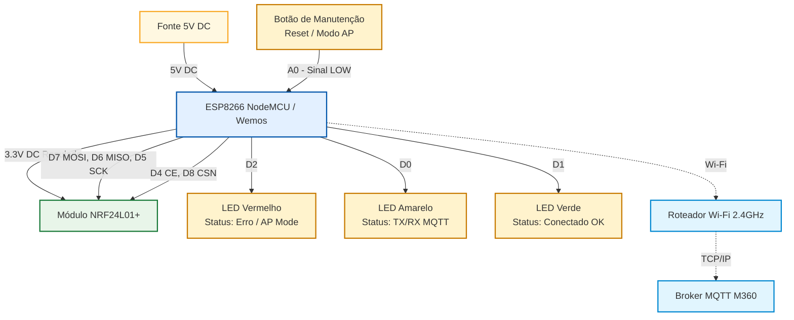

# Esquema Elétrico — Gateway MQTT (M360-DRY)

O diagrama a seguir detalha as conexões físicas e lógicas do **Gateway MQTT**, responsável por fazer a ponte de comunicação entre os nós sensores/atuadores da rede MySensors (via rádio nRF24L01+ no protótipo, ou RFM95W no mezanino da M360-GW — o rádio ativo vem de `[common] radio_flags`) e o servidor central M360 (via rede Wi-Fi e MQTT).

## Diagrama de Conexões (Mermaid)

## Tabela de Pinagem (Pinout)

> Esta tabela e o diagrama acima são do **protótipo** (env `d1_mini_gateway`), que tem nRF24.
> O env é fixo em nRF24 (`[proto_rf24]` no `platformio.ini`), independentemente do `radio_flags`.
> Na placa M360-GW use `d1_mini_gw` (rádio selecionável, verde no D4; ver "Variante M360-GW" abaixo).

### NRF24L01 (Comunicação SPI)
| Pino Módulo | Pino NodeMCU (ESP8266) | Descrição |
| :--- | :--- | :--- |
| VCC | 3.3V | Alimentação estabilizada (Não usar 5V) |
| GND | GND | Referência de Terra |
| CE | D4 (GPIO2) | Chip Enable |
| CSN | D8 (GPIO15) | Chip Select Not |
| SCK | D5 (GPIO14) | Serial Clock (SPI Padrão) |
| MOSI | D7 (GPIO13) | Master Out Slave In (SPI Padrão) |
| MISO | D6 (GPIO12) | Master In Slave Out (SPI Padrão) |

### LEDs de Status
Acompanham o estado da conectividade do Gateway.
| Componente | Pino NodeMCU | Descrição |
| :--- | :--- | :--- |
| **LED Vermelho** | D2 (GPIO4) | Erro, Módulo sem WiFi ou Operando em Modo AP (Configuração) |
| **LED Amarelo** | D0 (GPIO16) | Transmitindo/Recebendo dados via MQTT ou Inicializando |
| **LED Verde** | D1 (GPIO5) | Conectado com sucesso (WiFi e MQTT OK) e rádio operante |

### Botão de Manutenção
| Componente | Pino NodeMCU | Descrição |
| :--- | :--- | :--- |
| **Botão (Push Button)** | A0 | Se pressionado no boot (ligado ao GND), força o NodeMCU a entrar em modo Access Point (AP) para reconfiguração das credenciais Wi-Fi e MQTT via Portal Cativo (192.168.4.1). |

---

## Variante M360-GW (env `d1_mini_gw`)

A placa M360-GW (`hardware/m360-gw/`, detalhes em `hardware/ARQUITETURA_FAMILIA.md` §6) usa o mesmo
fonte `libDryGatewayMqtt.cpp`. A diferença fica atrás da flag `-D M360_BOARD_GW`, que só o env
`d1_mini_gw` define; `d1_mini_gateway` continua servindo o protótipo acima.

| Sinal | Protótipo | M360-GW | Observação |
| :--- | :--- | :--- | :--- |
| **LED Verde** | D1 (GPIO5) | **D4 (GPIO2)**, via 2N7002 **Q1** | O D4 comanda só o gate; o LED vai do 3,3 V ao dreno. Ativo em HIGH como os outros dois (`M360Leds.h`, `#ifdef M360_BOARD_GW`). O LED azul do D1 mini, no mesmo GPIO2, fica invertido (só estética) |
| LED Vermelho / Amarelo | D2 / D0 | D2 / D0 | Sem mudança; resistores de 470 Ω a bordo, LEDs no painel pelo J3 (6 vias, em pares) |
| Rádio RFM95W (mezanino J1) | — | DIO0 = **D1** (GPIO5), NSS = D8 (GPIO15), SPI D5/D6/D7 | Padrões da lib no ESP8266, sem flag. DIO1 e RESET **não ligados** — não definir `MY_RFM95_RST_PIN` |
| nRF24 legado (header J4) | CE = D4, CSN = D8 | CE = **D1** (GPIO5), CSN = D8 | `-D MY_RF24_CE_PIN=5` no env. Exclusivo com o mezanino: um rádio por placa. Pino 6 (IRQ) do J4 sem ligação |
| Modo AP | Botão no A0 | **Reed SW1** no A0, pull-up 10 kΩ | Mesmo firmware: ímã por fora da caixa no boot força o modo AP. Sem factory reset pelo ímã |

---
**Nota:** A alimentação de 3.3V fornecida pelo próprio regulador linear da placa NodeMCU/Wemos geralmente é suficiente para o NRF24L01+ operando em modo baixo consumo (PA_LOW). Contudo, em caso de instabilidade ou se for utilizar um rádio NRF24L01+ PA/LNA (com antena externa e amplificador de potência), recomenda-se estritamente adicionar um módulo regulador/adaptador de tensão independente de 3.3V ligado diretamente à fonte de 5V.
